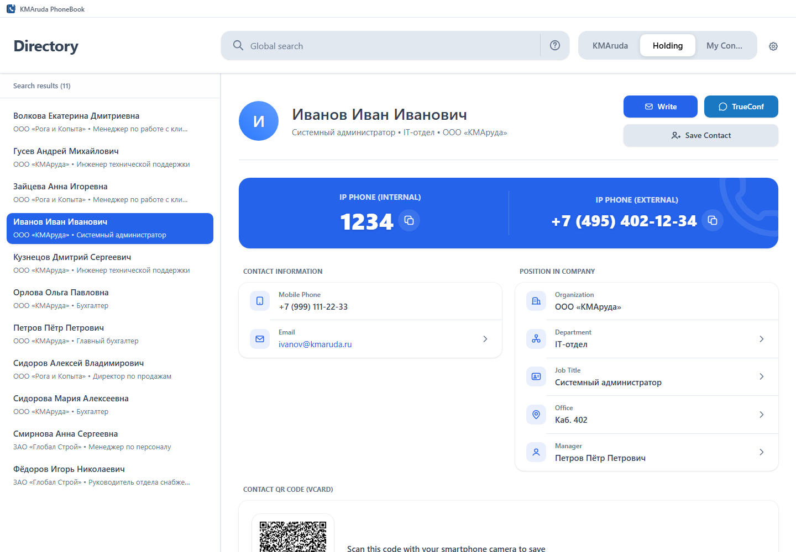

<p align="center">
  
</p>

<h1 align="center">KMAruda PhoneBook</h1>

<p align="center">
  <b>A corporate phone book backed by Active Directory.</b><br>
  Fast search by full name, department, job title, office, phone and e-mail,
  employee profiles, QR vCards and vCard export.
</p>

<p align="center">
  <picture>
    <source media="(prefers-color-scheme: dark)" srcset="screenshots/home-dark.png">
    
  </picture>
  <br>
  <sub>Search, employee profile and QR vCard in a single window.</sub>
</p>

The application is a **Windows-first desktop app** built with Tauri 2: a
React/TypeScript interface, a Rust backend and an encrypted local SQLite cache.
A browser demo mode with mock data is available for UI work.

## Features

- prefix and substring search (FTS5 + trigrams), including keyboard-layout
  and phone-format normalization;
- e-mail and phone-tail search;
- synchronization across multiple AD connections and an external Yealink XML
  phone book;
- employee profile with manager and colleagues by department, job title or
  office;
- favorites, holding-wide global mode and organization groups;
- AES-256-GCM encryption for the local cache; AD passwords stay in the OS
  keyring;
- English and Russian interface, light/dark/system themes and animation
  settings.

## Stack

- **Frontend:** React 19, TypeScript, Vite 8, TanStack Query/Virtual,
  Zustand, Tailwind CSS 4, Motion.
- **Backend:** Rust, Tauri 2, rusqlite (FTS5, trigram), ldap3, AES-GCM,
  keyring.
- **Tests/CI:** Vitest, Rust unit tests, GitHub Actions (clippy, fmt, cargo
  audit, CodeQL, dependency review, OSV).

## Getting started

Requirements: Windows 10/11 x64, Node.js 20+, Rust stable (MSRV 1.89), MSVC
Build Tools and the Windows SDK, and the
[Tauri prerequisites](https://v2.tauri.app/start/prerequisites/).

```powershell
npm install
npm run tauri dev
```

Browser demo mode:

```powershell
npm run dev
```

## Checks

```powershell
npm run format:check
npm run typecheck
npm run lint
npm test
npm run check:locales
npm run check:version
cargo fmt --manifest-path src-tauri/Cargo.toml -- --check
cargo clippy --manifest-path src-tauri/Cargo.toml --all-targets -- -D warnings
cargo test --manifest-path src-tauri/Cargo.toml --locked
```

Search load benchmark (not part of the regular `cargo test`):

```powershell
cargo test --release --manifest-path src-tauri/Cargo.toml search_load_benchmark -- --ignored --nocapture
```

## Layout

| Path | Purpose |
| --- | --- |
| `src/features/contacts` | Directory screen, search and employee profile |
| `src/features/settings` | AD, interface, groups and import/export settings |
| `src/services` | Contact-source contract, Tauri and demo implementations |
| `src-tauri/src/commands` | Typed IPC boundary |
| `src-tauri/src/services/ldap` | LDAP/AD client and record parsing |
| `src-tauri/src/services/db` | SQLite cache, FTS/trigrams and encryption |
| `docs` | Contributing, security policy, code of conduct and signing notes |

## Documentation

- [Contributing](CONTRIBUTING.md)
- [Security policy](SECURITY.md)
- [Code of Conduct](CODE_OF_CONDUCT.md)
- [Code signing and updates](CODE_SIGNING.md)
- [Third-party notices](THIRD_PARTY_NOTICES.md)

## License

MIT — see [LICENSE](../LICENSE).
